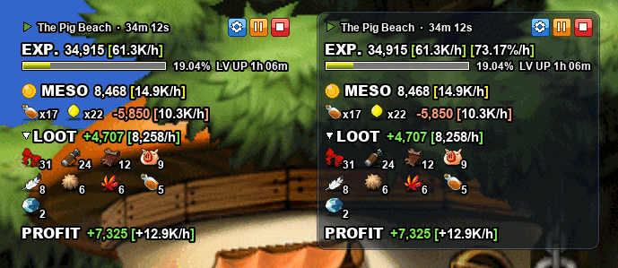
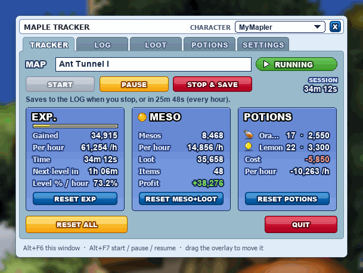
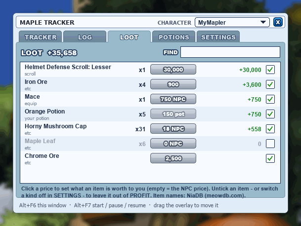
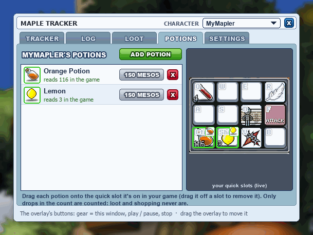
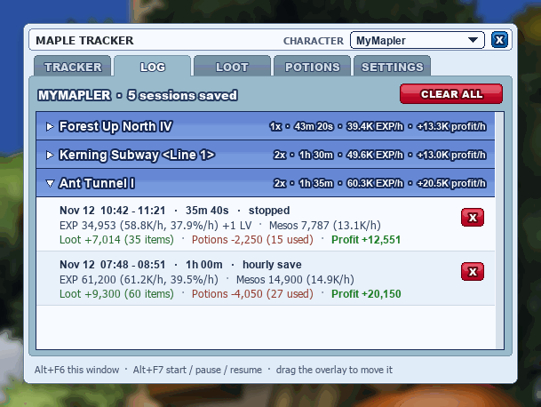
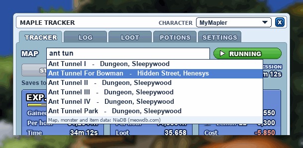
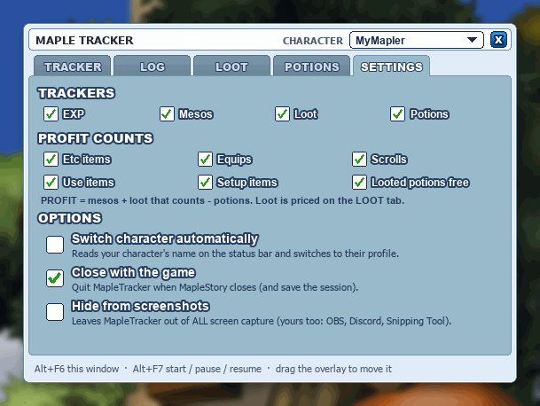
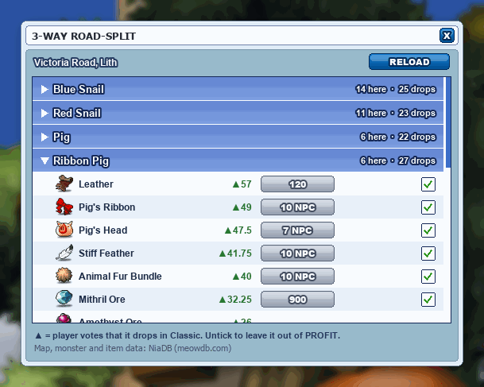

# MapleTracker

**See exactly what your grind is worth.** A game-style overlay for MapleStory Classic that tracks your EXP, mesos, loot, potions and profit per hour while you hunt.

<p align="center"></p>

- **EXP per hour**, as raw EXP, level % or both, plus time to your next level
- **Mesos per hour**, counted from your pickup messages
- **Loot**: every item you pick up, with its icon and what it's worth
- **Potions used**, read from your own quick slots
- **Profit per hour**: mesos + loot − potions, in green or red
- **A log of every session**, per map and per character, so you can compare training spots

**Safe by design.** MapleTracker only looks at the screen. It never reads game memory, never injects anything, never sends keys or clicks to the game, and doesn't listen to your keyboard.

## Getting started

1. Install [Python](https://www.python.org/) 3.10 or newer (Windows 10 or 11).
2. Install what MapleTracker needs:
   ```
   python -m pip install mss numpy opencv-python pillow winrt-runtime winrt-Windows.Media.Ocr winrt-Windows.Graphics.Imaging winrt-Windows.Storage.Streams winrt-Windows.Globalization winrt-Windows.Foundation winrt-Windows.Foundation.Collections
   ```
3. Double-click **`Start MapleTracker.bat`**.

The overlay appears over the game. Press **▶** to start a session, and the **⚙** button opens the tracker window. MapleTracker closes by itself when you close MapleStory.

## A quick tour

| | |
|---|---|
|  |  |
| **Tracker:** your current session at a glance | **Loot:** everything you picked up and what it's worth |
|  |  |
| **Potions:** drag your potions onto your quick slots | **Log:** past sessions by map, with EXP/h and profit/h |
|  |  |
| **Map:** type a few letters and pick your map | **Settings:** choose what to track and how it looks |

<sub>The pictures use made-up sample data.</sub>

## How to use it

### The overlay

- **⚙ / ▶ / ⏸ / ■** at the top right open the tracker window, start or pause, and stop and save.
- **Drag** the overlay anywhere; it remembers where you put it.
- **Click LOOT** to show or hide a grid of everything you've picked up.
- In **Settings**, give it a light or dark background (with an opacity slider) so it's easy to read on any map, and pick how EXP is shown: EXP/h, %/h or both.

### Hunting sessions

- MapleTracker **starts stopped**, so walking around town doesn't count. Press ▶ when you start hunting.
- **Pause** freezes everything, the clock included.
- Type your map's name in the **MAP** box. The session is then saved to your **Log** when you press stop, every hour, and when the game closes.

### Loot and profit

- Pickups are counted as they happen, with the item's icon and value.
- Items are worth their NPC price until you set your own: click a price on the **Loot** tab and type `2500`, `25k` or `1.5m`.
- Untick an item (or a whole kind, like equips, in **Settings**) to leave it out of your profit.
- Potions you loot count as free, so drinking them later doesn't look like a loss.

### Potions

- On the **Potions** tab, add the potions you use, then drag each one onto its quick slot in the live picture of *your* quick slots.
- Only potions you drink are counted. Looting or buying more doesn't throw it off.

### Maps and drops

- Start typing in the **MAP** box and pick your map from the list.
- **MOBS** shows the map's monsters and what they drop in MS Classic, ranked by player votes, with each item's price.

<p align="center"></p>

### Characters

- MapleTracker reads your character's name and keeps separate logs and potions for each one, switching automatically when you change characters.
- You can also switch, add or rename characters from the **Character** menu in the tracker window.

## Tips

- **Keep it clear of the status bar, your quick slots and the bottom-right messages.** MapleTracker reads those, and the overlay shows a red warning if it's covering one.
- **Recording or streaming?** "Hide from screenshots" in Settings lets the overlay sit anywhere, but it then won't show up in OBS or Discord either.
- **Nothing being read?** Windows' text reader needs an English language pack: Settings > Time & language > Language.
- **Lost the tracker window?** Right-click the overlay, or start MapleTracker again.

<details>
<summary><b>Technical details</b></summary>

### How it reads the game

- **EXP:** the number on the status bar (`EXP. 62,312 [85.27%]`), matched against digit templates. It's the game's own total, so kill EXP, party bonus EXP and quest EXP all count exactly once. A reading only counts when it repeats and agrees with the percentage.
- **Mesos and pickups:** the messages at the bottom right, read with Windows' built-in OCR. Each message is followed as the stack scrolls up, so it's counted exactly once. Garbled or cut-off item names ("Animal Fur Bun...") are matched to real item names, preferring items your current map drops.
- **Potions:** the count on each quick slot, read on the game's own 1366x768 pixel grid. Only drops in the count are counted; a drop of more than 12 at once is treated as moving the stack.
- It only reads while the game window is in front.

### Item and map data

Map names, item names, icons, NPC prices and monster drops come from [NiaDB](https://meowdb.com). Looked-up data is kept in `meowdb_cache/`. Online lookups are off by default (`"niadb_online"` in `tracker_config.json`); when on, MapleTracker asks for at most one page every 10 seconds and stops if NiaDB refuses. Pages saved from meowdb.com with Ctrl+S into `meowdb_import/` are imported too.

NPC sell prices, and the monsters on a map, can be filled in from the [MapleClassic Wiki](https://mapleclassic.wiki) with `python tools/fetch_prices.py` (add `--map "The Murky Swamp II"` for a map). It's run by hand, looks up only what's missing, and asks for 50 pages at a time, a few seconds apart. A price from a saved NiaDB item page always wins.

### Files and settings

- `tracker_config.json`: screen positions (in game units, measured on a 2560x1440 window), overlay and window size (`overlay_scale`, `window_scale`), and `native_size` if your game doesn't render at 1366x768.
- `profiles/`: each character's logs and potions. `prices.json`: your item prices.
- `python maple_tracker.py --debug` logs every EXP change, pickup and potion use to `tracker_log.txt`.
- `tools/build_glyphs.py` and `tools/build_count_glyphs.py` rebuild the digit templates from labelled recordings (not included, as they show other players' names and chat).

</details>

## Credits

- Map, monster and drop data: [NiaDB](https://meowdb.com), used with permission.
- NPC sell prices and map monsters: [MapleClassic Wiki](https://mapleclassic.wiki), under [CC BY-NC-SA 4.0](https://creativecommons.org/licenses/by-nc-sa/4.0/). Data taken from the wiki keeps that license, and each item records the wiki page it came from.
- MapleStory is a trademark of NEXON. MapleTracker is a fan-made tool and isn't affiliated with NEXON or NiaDB.

## License

All rights reserved for now: MapleTracker isn't released yet, and the code may not be copied or republished (see [LICENSE](LICENSE)). It will be released under an open license once it's ready. The only official copy is this repository, [bookard-dev/MapleTracker](https://github.com/bookard-dev/MapleTracker).
